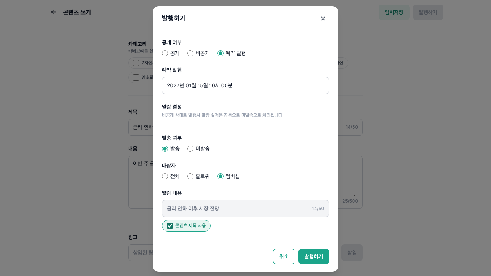
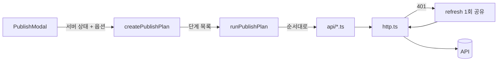

# US Alliance 콘텐츠 관리 어드민

콘텐츠를 작성·발행하고 푸시 알람을 예약하는 운영자용 웹 앱입니다. React 19 + TypeScript + Tailwind 4 + TanStack Query.



## 실행 방법

- Node 26.10.0 / npm
- 환경변수는 없습니다. API 주소(`https://fe-assignment-api.us-insight.com`)는 `src/api/http.ts`에 상수로 있습니다.

```bash
npm install
npm run dev          # http://localhost:5173
npm test             # 단위 테스트 (Vitest)
npm run typecheck    # tsc -b
npm run lint
npm run build
```

회원가입 후 바로 로그인 상태가 됩니다.

## 이어받는 분께 먼저

- 가장 복잡한 곳은 **발행 모달**입니다. 공개 상태·예약 일정·알람이 서로 다른 API여서, "현재 서버 상태 + 고른 옵션 → 호출할 API 목록"을 순수 함수 [`createPublishPlan`](src/domains/contents/publish/publishPlan.ts)으로 계산하고 [`runPublishPlan`](src/domains/contents/publish/runPublishPlan.ts)이 순서대로 실행합니다. 동작은 [`publishPlan.spec.ts`](src/domains/contents/publish/publishPlan.spec.ts)를 읽으면 상태 조합별로 볼 수 있습니다.
- 토큰 재발급은 [`src/api/http.ts`](src/api/http.ts) 한 곳에 있습니다. 401이면 refresh를 한 번만 하고(동시 요청은 같은 refresh를 기다림) 원요청을 재시도합니다.
- 결정 이유는 [`docs/adr/`](docs/adr/)에 있습니다.

## 구현 범위

요구사항을 R-1~R-27로 나누고 Must / Should / Nice로 우선순위를 정했습니다.

- [x] 회원가입·로그인, 토큰 저장, Access 만료 시 재발급 후 재시도 (R-1~3)
- [x] 로그아웃 (R-4, Should)
- [x] 인증 가드, API 에러 문구 표시 (R-5, R-6)
- [x] GNB, 콘텐츠 목록·페이지네이션, 행 호버 시 "푸시알림 생성" (R-7~10)
- [x] 콘텐츠 필터: 카테고리·상태 (R-11, Should)
- [x] 알람 목록 (R-12)
- [x] 새글쓰기 모달, 작성 폼 검증, 생성·수정 (R-13~15)
- [x] 임시저장: 헤더 버튼 + 30초 자동 (R-16)
- [x] 발행 모달: 표시 규칙, API 호출 순서, 예약 시간, 검증 문구 (R-18~21)
- [x] 알람 작성, 작성 중 이탈 확인 (R-22, R-23)
- [x] 탭·페이지·필터를 URL 쿼리로 유지 (R-27, Nice). 새로고침과 브라우저 뒤로가기에는 유지되고, 작성 화면의 ← 버튼은 목록 첫 화면으로 돌아갑니다
- [ ] 예약 알람 수정·삭제 (R-24, Nice) — 하지 않음, 아래 "하지 않은 것" 참고

### 요구사항 해석과 가정

| 모호했던 점                             | 가정                                                                            | 확인 위치                                                                            |
| --------------------------------------- | ------------------------------------------------------------------------------- | ------------------------------------------------------------------------------------ |
| 임시저장 "1개만"의 범위                 | 신규 작성만 저장. 수정 화면에는 임시저장 버튼 없음                              | [ADR 0002](docs/adr/0002-draft-only-for-new-content.md), `draftStorage.spec.ts`      |
| 발행 API 중간 실패                      | 모달 유지 + 에러 표시. 재시도하면 서버 상태를 다시 읽어 남은 단계만 호출        | [ADR 0003](docs/adr/0003-sequential-publish-plan.md), `publishPlan.spec.ts` "재시도" |
| 공개 발행 이력이 있는 콘텐츠의 예약     | 예약 발행 비활성 + 안내 문구                                                    | `publishPlan.spec.ts` "공개발행 이력"                                                |
| 비공개로 발행할 때 알람                 | 미발송으로 고정, 기존 예약 알람은 삭제 (시안 문구)                              | `PublishModal.spec.tsx`, `publishPlan.spec.ts` "비공개"                              |
| "공개 + 발송"인데 예약 알람이 이미 있음 | 비공개·예약에서 공개로 바꿀 때는 지금 발송. 이미 공개된 콘텐츠면 예약 시각 유지 | `publishPlan.spec.ts` "예약 알람"                                                    |
| 발행 모달 첫 화면                       | 처음 발행하면 "공개 + 발송"(시안), 알람 없는 공개 콘텐츠는 "미발송"             | `PublishModal.spec.tsx`                                                              |
| 예약 시간 표시의 "ss분"                 | "mm분"의 오타로 보고, 시간은 10분 간격으로 선택                                 | —                                                                                    |
| 알람 작성 페이지의 발송 시각            | 항상 예약 발송 (시간 필수)                                                      | `validateNotification.spec.ts`                                                       |
| 이미 알람이 있는 콘텐츠                 | 목록에서 "푸시알림 생성" 숨김, 직접 들어오면 서버 409 문구 표시                 | e2e (레포 밖)                                                                        |
| 발행 모달 취소                          | 신규는 저장된 콘텐츠의 수정 화면으로 이동, 수정은 모달만 닫음                   | e2e (레포 밖)                                                                        |

## 아키텍처

```
src/
├─ api/            외부 계약: 엔드포인트 함수, 응답 타입, queryOptions, http·토큰 저장
├─ components/     두 도메인 이상이 쓰는 UI (Modal, DateTimeField, 레이아웃 3종 …)
├─ domains/
│  ├─ auth/        로그인·가입 폼, 가드, 로그아웃
│  ├─ contents/    목록·필터, 작성 폼, 임시저장
│  │  └─ publish/  발행 모달, 호출 계획(순수 함수), 순차 실행, 검증
│  └─ notifications/  목록, 작성 폼, 이탈 확인
├─ pages/          라우트. 도메인 조합은 여기서만
└─ utils/          날짜 포맷·KST 변환, id 파싱
```

- 함께 바뀌는 파일을 도메인 폴더에 모았습니다. 도메인은 `index.ts`로만 밖에 노출하고, 도메인끼리는 import하지 않습니다.
- 발행 모달은 콘텐츠 도메인이지만 알람 API를 씁니다. 그래서 API 함수와 타입은 `src/api/`에 공용으로 두었습니다.



발행 모달은 순수 함수로 호출 목록을 만들고, 실행부가 그 목록을 순서대로 API로 보냅니다. 모든 요청은 `http.ts`를 거치며, 401이면 재발급을 한 번 한 뒤 재시도합니다.

## 주요 의사결정

자세한 대안과 결과는 [docs/adr](docs/adr/README.md)에 있습니다.

### 발행 API는 순수 함수로 계획하고 순차 실행 ([0003](docs/adr/0003-sequential-publish-plan.md))

- 상황: 공개 상태·예약·알람이 각각 다른 API이고 트랜잭션이 없습니다. 같은 옵션이라도 서버 상태에 따라 부를 API가 다릅니다.
- 선택: 계획(순수 함수)과 실행을 나누고, 실패하면 모달을 유지합니다. 재시도는 서버 상태를 다시 읽어 남은 단계만 수행합니다.
- 이유: 롤백 API가 모든 단계에 있지 않습니다. 변화가 있는 단계만 만들면 재시도가 멱등에 가까워집니다.
- 포기한 것: 부분 성공 상태가 잠깐 보일 수 있습니다.
- 커밋: `8c78555`, `39619e4`

### 토큰은 localStorage, 401이면 refresh 한 번 후 재시도 ([0005](docs/adr/0005-token-storage-and-refresh.md))

- 상황: API가 토큰을 응답 본문으로 주고 Bearer 헤더를 요구합니다. httpOnly 쿠키를 쓸 수 없습니다.
- 선택: 두 토큰을 localStorage에 둡니다. 동시에 받은 401은 refresh 하나를 공유합니다.
- 이유: Access만 메모리에 둬도 Refresh가 storage에 남아 이득이 작습니다. 실제 방어선은 XSS 차단이라, 링크는 http/https만 허용하고 `dangerouslySetInnerHTML`은 쓰지 않습니다.
- 재검토 조건: 서버가 httpOnly 쿠키를 지원하면 옮깁니다.
- 커밋: `5a1b909`

### 임시저장은 신규 작성에만 ([0002](docs/adr/0002-draft-only-for-new-content.md))

- 상황: "1개만 저장"이고 이어쓰기 진입점은 새글쓰기 모달뿐인데, 시안의 수정 화면에도 임시저장 버튼이 있습니다.
- 선택: 신규만 저장합니다.
- 이유: 수정은 서버에 원본이 있고, 수정 중인 글을 다시 꺼낼 경로가 없습니다.
- 포기한 것: 수정 중 이탈하면 고친 내용이 사라집니다.

### 서버 상태 TanStack Query, 폼은 직접 상태 + 순수 검증 함수 ([0004](docs/adr/0004-tanstack-query.md), [0006](docs/adr/0006-forms-with-local-state.md))

- 조회는 Suspense + ErrorBoundary로 통일했습니다. 폼은 필드가 4개 이하여서 라이브러리 대신 `validateXxx(values)` 순수 함수를 두고, 그 함수를 바로 테스트했습니다.

## 테스트

| 대상                                                                           | 레벨                       | 이유                                             |
| ------------------------------------------------------------------------------ | -------------------------- | ------------------------------------------------ |
| 발행 호출 계획, 순차 실행·중간 실패                                            | 단위                       | 상태 조합이 가장 많고, 틀리면 알람이 잘못 발송됨 |
| 토큰 재발급·동시 401·refresh 실패                                              | 단위                       | 타이밍 문제라 화면으로 확인하기 어려움           |
| 폼·발행 모달 검증, 임시저장 저장소, 날짜·KST 변환                              | 단위                       | 규칙이 문서(시안 노트)로 정해져 있음             |
| 발행 모달 표시 규칙, Modal ESC                                                 | 컴포넌트 (RTL)             | 라디오 비활성·초기값 같은 화면 규칙              |
| 로그인 → 작성 → 예약 발행 + 알람 → 목록 배지, 알람 작성·이탈 확인, 리뷰 수정분 | e2e (Playwright, API 모킹) | 여러 화면에 걸친 흐름과 요청 본문                |

- 단위·컴포넌트: 16개 파일, 126개 (`npm test`).
- e2e 10개 시나리오는 API를 모킹해 레포 밖에서 돌렸습니다. 과정 산출물이라 레포에는 넣지 않았습니다.
- 실제 API로는 회원가입부터 예약 발행까지 직접 확인했습니다.

테스트하지 않은 것:

- 픽셀 단위 시안 일치: 기능과 흐름을 우선했습니다.
- 모바일 레이아웃: 데스크톱 우선이고, 좁은 화면에서 깨지지 않는 정도만 맞췄습니다.
- 로그아웃·필터 e2e: 단순한 흐름이라 직접 확인으로 대신했습니다.

## 하지 않은 것 · 한계

| 항목                                               | 이유 / 시간이 더 있다면                                                                                                           |
| -------------------------------------------------- | --------------------------------------------------------------------------------------------------------------------------------- |
| 예약 알람 수정·삭제 (R-24)                         | Nice 우선순위. API는 `src/api/notifications.ts`에 있으니, 알람 목록의 예약 행에서 작성 폼을 수정 모드로 여는 것부터 하면 됩니다   |
| 수정 화면 임시저장                                 | ADR 0002. 수정 중 이탈하면 내용이 사라집니다                                                                                      |
| 작성 페이지에서 브라우저 뒤로가기 막기             | 헤더 ← 버튼만 이탈 확인을 합니다. 알람 작성도 같습니다                                                                            |
| 범위를 벗어난 페이지(`?page=99`)나 결과 0건인 필터 | "작성한 콘텐츠가 없습니다"만 보이고 1페이지로 가는 링크가 없습니다                                                                |
| 모달 포커스 트랩                                   | 열릴 때 포커스는 옮기지만 Tab으로 뒤쪽 화면에 갈 수 있습니다. 중복 생성 위험이 있는 헤더 버튼은 모달이 열린 동안 비활성화했습니다 |
| 토큰 저장 위치                                     | localStorage라 XSS에 노출됩니다. 방어는 ADR 0005                                                                                  |
| 응답 날짜가 빈 문자열일 때                         | 포맷 함수가 예외를 던져 목록 전체가 에러 화면이 됩니다. 실제 API에서는 보지 못했습니다                                            |
| 번들 크기                                          | 580KB(gzip 171KB)로 Vite 경고가 뜹니다. 라우트 단위 분할을 하지 않았습니다                                                        |

## AI 활용

- 도구: Claude Code 2.1.292
- 모델: Claude Opus 5.5 (`claude-opus-5-5`). 메인 세션과 서브에이전트 모두 같은 모델
- 하네스: [`harness/`](harness/README.md)에 실제로 쓴 규칙·스킬·에이전트·hook을 그대로 넣었습니다.

| 단계     | AI                                             | 나                                        |
| -------- | ---------------------------------------------- | ----------------------------------------- |
| 요구사항 | 시안 노트 전사, 요구사항·가정 후보 정리        | 우선순위와 가정 확정                      |
| 설계     | 대안과 추천, 보안 검토                         | 선택과 이유                               |
| 구현     | 커밋 단위 구현 (독립 단위는 서브에이전트 병렬) | 그룹마다 확인 후 커밋 승인                |
| 검증     | 단위·e2e 작성, 새 맥락 리뷰 두 개              | 실제 API 확인, 리뷰 지적별 수정·수용 결정 |

**판단 사례**

1. 토큰 저장: AI가 localStorage를 추천했고, 저는 "보안상 문제가 없는지 검토"를 요구한 뒤 채택했습니다. 검토 결과로 링크 프로토콜 제한과 실패 시 storage 비우기가 들어갔습니다(ADR 0005).
2. refresh 네트워크 오류: AI가 "잠깐 끊긴 것으로 작성 중인 사용자가 로그인 화면으로 튕기면 안 된다"며 토큰 유지를 제안했고, 그 이유 그대로 채택했습니다(결정 로그 N-23).
3. 발행 모달 기본값: 처음엔 모든 경우 "발송"으로 열리게 했는데, 리뷰에서 알람 없는 공개 콘텐츠를 고치면 빈 알람 제목 때문에 막힌다는 지적이 나왔습니다. 그래서 첫 발행과 기존 알람이 있을 때로 범위를 좁혔습니다(N-42 → N-46).
4. 리뷰 결과 검증: 새 맥락 리뷰어가 "이미 공개된 콘텐츠의 예약 알람이 재발행 때 즉시 발송된다"는 버그를 찾았고, 코드로 재현한 뒤 고쳤습니다(`39619e4`).

**검증 방식**: 커밋 그룹마다 typecheck·lint·테스트·모킹 e2e를 돌린 뒤 승인했습니다. 리뷰는 결정 기록을 보지 않은 서브에이전트 두 개(품질 / 영향 범위)에게 맡겼습니다. 리뷰 수정 중 단위 테스트는 통과했지만 브라우저에서는 실패하는 경우가 있었습니다. e2e로 이를 잡아 구조를 바꿨습니다(N-48).
